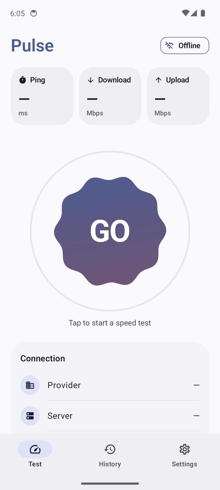
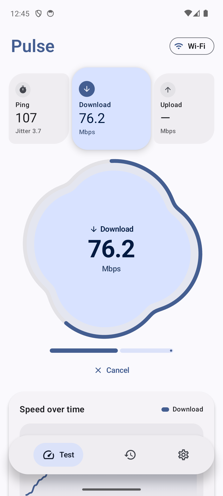
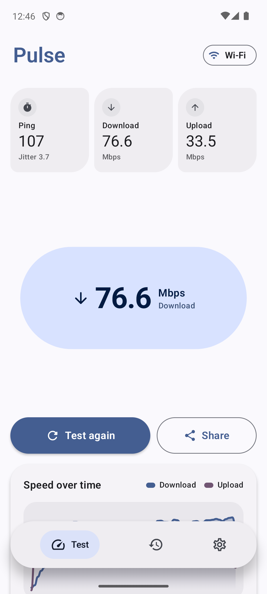
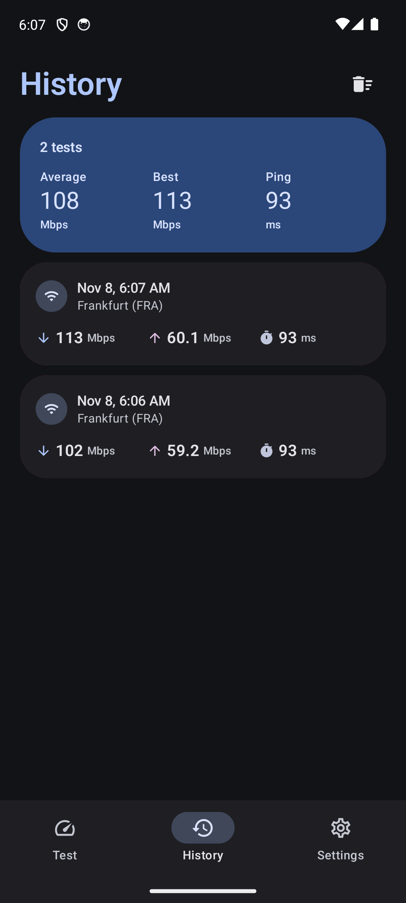

# Pulse: internet speed test for Android, Windows, Mac & LG webOS TV

A fast, modern speed test app built with **Jetpack Compose / Material 3 Expressive** and multiplatform client engines.
It measures ping, jitter, download, upload and **bufferbloat / loaded latency** against your choice of Cloudflare, Ookla (speedtest.net), FAST (Netflix) or LibreSpeed servers.

<p align="center">
  
  
  
  
</p>

## Downloads

| Platform | Package | Description |
|:---|:---|:---|
| **Android / Android TV / Fire TV** | [`Pulse-v1.5.0.apk`](https://github.com/dor2500/pulse-speed/releases/latest) | Android 8.0+ APK with Leanback TV launcher banner & Material You |
| **Stremio Addon** | [`Pulse-v1.5.0-stremio-addon.zip`](https://github.com/dor2500/pulse-speed/releases/latest) | Stremio Community Addon with `stremio://` protocol support |
| **LG webOS Smart TV** | [`Pulse-v1.5.0-webos.ipk`](https://github.com/dor2500/pulse-speed/releases/latest) | LG Smart TV `.ipk` package with TV remote & Magic Remote support |
| **Samsung Smart TV (Tizen)** | [`Pulse-v1.5.0-tizen.wgt`](https://github.com/dor2500/pulse-speed/releases/latest) | Samsung Tizen TV widget package (`.wgt`) |
| **Kodi Media Center** | [`Pulse-v1.5.0-kodi-addon.zip`](https://github.com/dor2500/pulse-speed/releases/latest) | Kodi Python addon (`plugin.program.pulsespeed`) |
| **Linux (Debian / Ubuntu / Pi)** | [`pulse_1.5.0_all.deb`](https://github.com/dor2500/pulse-speed/releases/latest) | Native Debian/Ubuntu package with app launcher |
| **Linux (Tarball)** | [`Pulse-v1.5.0-linux.tar.gz`](https://github.com/dor2500/pulse-speed/releases/latest) | Universal portable Linux archive |
| **Windows Desktop** | [`Pulse.exe`](https://github.com/dor2500/pulse-speed/releases/latest) / [`.zip`](https://github.com/dor2500/pulse-speed/releases/latest) | Standalone portable executable (no install required, 90 KB) |
| **macOS Desktop** | [`Pulse-v1.5.0-mac.zip`](https://github.com/dor2500/pulse-speed/releases/latest) | Standalone `Pulse.app` bundle for Mac |
| **Universal CLI** | [`pulse-cli.py`](https://github.com/dor2500/pulse-speed/releases/latest) | Zero-dependency command-line speed tester |
| **Web Standalone** | [`Pulse-v1.5.0-web.zip`](https://github.com/dor2500/pulse-speed/releases/latest) | Standalone HTML5 web client |

<div dir="rtl">

### בעברית

**Pulse** היא אפליקציית בדיקת מהירות אינטרנט מהירה, מדויקת ומודרנית התומכת כעת כמעט בכל פלטפורמה אפשרית:
- **סמארטפונים וטאבלטים**: Android (קובץ APK).
- **טלוויזיות חכמות וסטרימרים**: טלוויזיות LG (קובץ IPK), טלוויזיות סמסונג (קובץ Tizen WGT), מכשירי Android TV, Google TV ו-Amazon Fire TV.
- **מרכזי מדיה**: תוסף מובנה ל-**Stremio** ותוסף ל-**Kodi**.
- **מחשבים שולחניים**: Windows (קובץ EXE עצמאי ללא התקנה), Mac (אפליקציית Pulse.app) ו-Linux (חבילת `.deb` ו-tar.gz).
- **טרמינל / CLI**: כלי פקודה מהיר (`pulse-cli.py`) לשרתים ולמפתחים.

היא מודדת פינג, ג׳יטר, הורדה, העלאה, **מדד Bufferbloat (פינג בעומס)**, אבחון רשת Wi-Fi, שמירה וייצוא היסטוריה ל-CSV ותמיכה מלאה בעברית.

**הורדות:** הורידו את הגרסה המתאימה לכם מ[דף הגרסאות הרשמי ב-GitHub](https://github.com/dor2500/pulse-speed/releases/latest).

</div>

## Features

- **Material You**: colors follow your wallpaper on Android 12+, plus light, dark and system themes
- **Material 3 Expressive design**: a compact floating pill navigation bar, asymmetric cards and pill buttons
- **Morphing gauge**: an organic four-petal shape that breathes, swells and spins faster with live speed, carries progress on an organic ring, and morphs into a capsule with the final result
- **Expanding cards**: the card for the running phase springs larger and lifts while its test runs
- **Four test networks**: Cloudflare, Ookla's speedtest.net servers, Netflix's FAST servers and LibreSpeed community servers, picked per test
- **Server picker**: like Speedtest, choose a specific Ookla, FAST or LibreSpeed server (with search, distance and live ping) or leave it on Automatic
- **Stop any time**: a Stop button ends the test instantly and discards the partial run
- **Ping and jitter**, measured over a warm connection with server processing time subtracted
- **Multi-stream download and upload**; the TCP warm-up window is discarded so slow start doesn't drag the result down
- **Speed-over-time graph** for download and upload
- **History** with a trend sparkline, averages and bests, Wi-Fi/Cellular filter chips; swipe a result to delete it
- **Connection details**: provider, server location, IP, network type and HTTP protocol
- **Share** a result as text
- Units in **Mbps or MB/s**, and three test lengths (quick, standard, thorough)
- **English and Hebrew** with full RTL support, switchable inside the app
- **In-app updates**: checks GitHub Releases, downloads the new APK and opens the installer

## How the measurement works

| Phase    | Method |
|----------|--------|
| Server   | Cloudflare uses its nearest data center. Ookla probes the nearest speedtest.net servers and uses the fastest. FAST asks Netflix for the closest Open Connect servers. LibreSpeed probes the community server list and uses the fastest responder. |
| Ping     | 12 small requests over a keep-alive connection; the median round trip (minus Cloudflare's reported `Server-Timing`). Jitter is the mean difference between consecutive samples. |
| Download | 6 parallel streams for the selected length. The first ~20% is warm-up and isn't counted. |
| Upload   | 4 parallel streams, measured the same way. |

Ookla and FAST are reached through the same public endpoints their own web apps call. They aren't official APIs, so they may change without notice.

## Build

Requirements: JDK 17 and the Android SDK (platform 36).

```bash
./gradlew assembleDebug
```

For a signed release, set `PULSE_KEYSTORE_PATH`, `PULSE_KEYSTORE_PASSWORD` and `PULSE_KEY_ALIAS`, then run
`./gradlew assembleRelease`. `scripts/release.sh v1.0.0` does this and publishes a GitHub release.

## Tech

Kotlin · Jetpack Compose · Material 3 · Coroutines / StateFlow · `HttpURLConnection` (no third-party networking libraries) · R8-minified, about 1 MB APK.

## License

[MIT](LICENSE)

---

Pulse is an independent project and isn't affiliated with Cloudflare, Ookla, Netflix or LibreSpeed.
