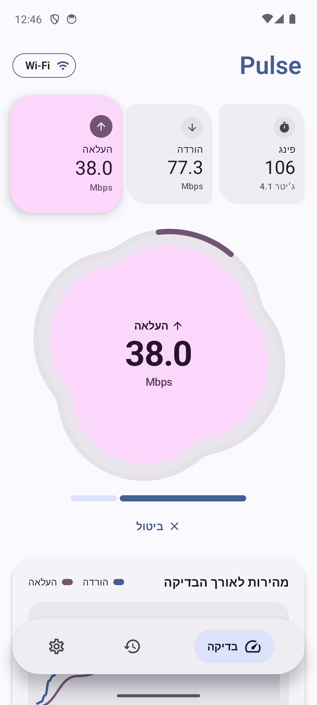

# Pulse: internet speed test for Android

A fast, modern speed test app built with **Jetpack Compose** and **Material 3 / Material You**.
It measures ping, jitter, download and upload against the Cloudflare speed test network.

<p align="center">
  
  
  
  
</p>

## Download

[](https://github.com/dor2500/pulse-speed/releases/latest)

Grab the latest signed APK from the [Releases page](https://github.com/dor2500/pulse-speed/releases/latest).
It needs Android 8.0 or newer.

<div dir="rtl">

### בעברית

**Pulse** היא אפליקציית בדיקת מהירות אינטרנט לאנדרואיד בעיצוב Material You מודרני.
היא מודדת פינג, ג׳יטר, הורדה והעלאה, שומרת היסטוריה של הבדיקות ותומכת בעברית מלאה.

**התקנה:** הורידו את קובץ ה-APK מ[דף הגרסאות](https://github.com/dor2500/pulse-speed/releases/latest), פתחו אותו בטלפון ואשרו התקנה ממקור לא ידוע אם תתבקשו. נדרש אנדרואיד 8.0 ומעלה.

</div>

## Features

- **Material You**: colors follow your wallpaper on Android 12+, plus light, dark and system themes
- **Material 3 Expressive design**: a floating pill navigation bar, asymmetric cards and pill buttons
- **Morphing gauge**: an organic four-petal shape that breathes, swells and spins faster with live speed, carries progress on an organic ring, and morphs into a capsule with the final result
- **Expanding cards**: the card for the running phase springs larger and lifts while its test runs
- **Ping and jitter**, measured over a warm connection with server processing time subtracted
- **Multi-stream download and upload**; the TCP warm-up window is discarded so slow start doesn't drag the result down
- **Speed-over-time graph** for download and upload
- **History** with averages and bests; swipe a result to delete it
- **Connection details**: provider, server location, IP, network type and HTTP protocol
- **Share** a result as text
- Units in **Mbps or MB/s**, and three test lengths (quick, standard, thorough)
- **English and Hebrew** with full RTL support, switchable inside the app
- **In-app updates**: checks GitHub Releases, downloads the new APK and opens the installer

## How the measurement works

| Phase    | Method |
|----------|--------|
| Ping     | 12 small requests over a keep-alive connection; median round trip minus Cloudflare's reported `Server-Timing`. Jitter is the mean difference between consecutive samples. |
| Download | 6 parallel streams from `speed.cloudflare.com/__down` for the selected length. The first ~20% is warm-up and isn't counted. |
| Upload   | 4 parallel streams posting to `speed.cloudflare.com/__up`, measured the same way. |

## Build

Requirements: JDK 17 and the Android SDK (platform 36).

```bash
./gradlew assembleDebug
```

For a signed release, set `PULSE_KEYSTORE_PATH`, `PULSE_KEYSTORE_PASSWORD` and `PULSE_KEY_ALIAS`, then run
`./gradlew assembleRelease`. `scripts/release.sh v1.0.0` does this and publishes a GitHub release.

## Tech

Kotlin · Jetpack Compose · Material 3 · Coroutines / StateFlow · `HttpURLConnection` (no third-party networking libraries) · R8-minified, about 1 MB APK.

## License

[MIT](LICENSE)

---

Pulse is an independent project and isn't affiliated with Cloudflare or Ookla.
